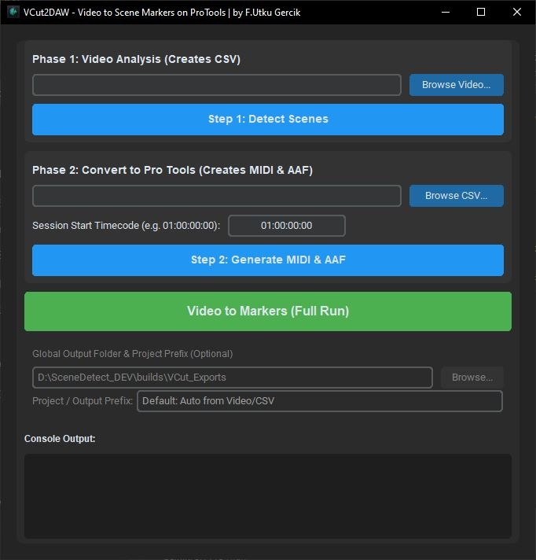

# VCut2DAW (Open Source Conform Assistant)

VCut2DAW is an open-source video-to-DAW pipeline tool designed specifically for Sound Editors and Assistant Editors. It automatically detects visual cuts from a video (or parses CMX3600 EDLs) and generates **100% compliant Dummy AAFs and MIDI Markers** perfectly synced for DAWs (Pro Tools, Nuendo, Reaper, Logic, etc.).



<br>

# 🚀 How to install and important security notes

### Option 1: Download Pre-built App (Recommended)
Go to the **[Releases](https://github.com/rhinofug/VCut2DAW/releases)** page and download the latest `.exe` (for Windows) or `.dmg` (for macOS).

> 💻 **Which Mac DMG do I need?**
> - **M1 / M2 / M3 / M4 Mac** → download `VCut2DAW_AppleSilicon.dmg`
> - **Older Mac with an Intel chip** → download `VCut2DAW_Intel.dmg`
> - **Not sure?** Click the Apple menu → **About This Mac** and look at "Chip" or "Processor". (The Intel DMG also runs on Apple Silicon through Rosetta, just slower.)

> 🛑 **IMPORTANT macOS SECURITY NOTE:** 
> Because this is a free open-source app, macOS Gatekeeper will automatically quarantine it when downloaded from the internet, which causes an *"App is damaged"* or *"Cannot be verified"* error. 
> 
> **To easily fix this:**
> 1. Open the `.dmg` and drag `VCut2DAW` into your **Applications** folder.
> 2. Open the **Terminal** app on your Mac.
> 3. Paste this command and hit Enter: `xattr -cr /Applications/VCut2DAW.app`
> 4. You can now open the app normally!

### Option 2: Compile from Source

**For Windows:**
Double click the `compile_windows.bat` file. It will automatically download dependencies, compile the source code into a standalone `.exe`, and place it in the `builds/` folder for you to run!

**For macOS / Linux:**
Open your terminal, navigate to the folder, and run:
```bash
chmod +x compile_mac.sh
./compile_mac.sh
```

---

## Why This Exists? (The Technical Edge)
- **DAW AAF Strictness (Pro Tools, Nuendo):** Pro Tools 12.5+ aggressively rejects standard OTIO AAFs. VCut2DAW uses `pyaaf2` to build compliant `SourceMob` and `MasterMob` hierarchies with valid `PCMDescriptor`s so DAWs (especially Pro Tools) never throw an import error.
- **Fractional Frame Rate & Sample-Accurate Sync (`23.976` / `29.97` / `59.94`):** Non-integer NTSC framerates leave fractional audio samples on every frame (e.g., `1601.6` samples/frame at 29.97 fps / 48 kHz). VCut2DAW uses exact broadcast rational ratios (`24000/1001`, `30000/1001`, `60000/1001`) and absolute sample/tick accumulation so cuts never drift even across 3-hour feature films.
- **The "1-Frame Drift" Fix:** AI cut detection often places the cut on the first *new* frame, resulting in a 1-frame offset compared to traditional NLE edits. PySceneDetect CSVs number frames from 1, so this tool converts all detected cuts to 0-based frames (1 frame left) and fills the timeline gap to ensure perfect frame sync with the picture department. EDL cuts are already exact NLE frame numbers and are not shifted.
- **The "120 BPM" MIDI Sync Issue:** DAWs (like Pro Tools) often force their session tempo (default 120 BPM) onto imported MIDI markers unless you overwrite the tempo map. This tool writes a Standard MIDI File (Type 1) at Pro Tools' native 960 PPQ with a fixed 120 BPM tempo (`ticks_per_beat = 960`, i.e. 1920 ticks per second), ensuring `01:00:00:00` lands exactly at 1 hour, not 30 minutes! Track 0 is a Conductor track (tempo, time signature, global markers) and Track 1 holds the track markers plus a short note at each cut.

## Features
- **One-Click Video to DAW Workflow:** Select an MP4/MOV/MKV/AVI video and get both frame-accurate MIDI Markers and a Pro Tools Dummy AAF in one click.
- **Auto & Manual Frame Rate Detection:** Automatically detects video framerate (`23.976`, `24`, `25`, `29.97`, `30`, `50`, `59.94`, `60` FPS) or lets you override it manually for EDLs.
- **EDL & CSV Support:** Got a CMX3600 `.edl` from the editor? Open the collapsible **Advanced** panel and convert `.edl` or `.csv` files directly!
- **Dummy AAF Generation:** Generates a Clip Track allowing you to use `Tab to Transient` (or clip boundaries) to jump between scenes.
- **Clean `VCut2DAW_Exports` Output Structure:** Automatically creates a `VCut2DAW_Exports` parent folder right next to your selected video (with `CSV/`, `MIDI/`, and `AAF/` subfolders).
- **Session Start Timecode Offset:** Input your session start (e.g., `01:00:00:00`) and the files will spot perfectly without manual offset mapping.

## 🖥️ System Requirements & DAW Compatibility

| Platform / DAW | Supported Versions & Details |
| :--- | :--- |
| **Pro Tools (Studio / Ultimate / HD)** | **Pro Tools 10, 11, 12.5 through Pro Tools 2025.12+**<br>• **PT 2022.9 – 2025.12+:** Full support for Global Ruler Markers (up to 32,000), Track Markers (2023.6+), and Dummy AAF Clip Tracks.<br>• **PT 10 / 11 / 12.5 – 2022.7:** Full Dummy AAF Clip Track support (unlimited cuts) + MIDI Markers (up to Pro Tools' legacy 999 Memory Locations limit). |
| **Pro Tools Intro / First** | MIDI Markers supported *(AAF import is disabled by Avid in free Intro/First editions)*. |
| **Other DAWs** | **Nuendo, Cubase, Logic Pro, Reaper, Studio One, DaVinci Resolve (Fairlight)** via standard SMF Type 1 MIDI & AAF. |
| **Windows** | **Windows 10 & Windows 11 (64-bit)**. |
| **macOS** | **macOS 11 Big Sur through macOS 15 Sequoia+** (Native **Apple Silicon M1 / M2 / M3 / M4** `.dmg` and **Intel x64** `.dmg` available). |

## 💡 Important Pro Tools / DAW Tips (FAQ)

**1. "My MIDI markers don't line up with the video!" (The 120 BPM Rule)**
DAWs like Pro Tools tie MIDI marker timecodes to the session's tempo map. **Your DAW session tempo MUST be set to exactly 120 BPM** when you import the MIDI file. If your session is set to 120 BPM, the markers will be 100% frame-accurate.

**2. Session Start Timecode Mismatch**
The `Session Start Timecode` you type into the VCut2DAW app (e.g. `01:00:00:00`) **must exactly match** your DAW's Session Start Time. If the app is set to `01:00:00:00` but your Pro Tools session starts at `00:00:00:00`, the AAF and MIDI will import 1 hour late.

**3. The AAF Audio is Offline / Empty?**
**This is intentional.** The tool generates a "Dummy" AAF track. It has no real audio. Its sole purpose is to create empty clips on your timeline so you can use the `Tab to Transient` (or `Tab to Clip Boundary`) shortcut to instantly jump your playhead to the exact start of the next visual scene cut.

## License
This project is licensed under the **Creative Commons Attribution-NonCommercial (CC BY-NC 4.0)** license.
You are free to use, share, and modify this code for your personal or studio workflows, but **you may not use this software for commercial monetization or sell it as a paid product/service**. 

## Author
**Furkan Utku Gerçik**  
Link: [https://rhinofug.github.io](https://rhinofug.github.io)  
GitHub: [github.com/rhinofug/VCut2DAW](https://github.com/rhinofug/VCut2DAW)

**Co-Dev: Muhammed Kol** (Muhammed Tayyib Kol)  
Link: https://github.com/muhammedtkol-alt

**Thanks to early testers:** Çağlar "Çakan" Çakmak, Can Doğduaslan, Ömür Öztürk, Çağdaş Yarman

<a href="https://buymeacoffee.com/rhinofug" target="_blank"></a>
 

*Protected with Watermark technology.*
## Acknowledgments & Open Source Credits
This project stands on the shoulders of giants. VCut2DAW would not be possible without the incredible work done by the open-source community. Special thanks to the creators of the core engines powering this app:

- **[PySceneDetect](https://github.com/Breakthrough/PySceneDetect) (by bcastillox):** For the incredibly robust frame-analysis and cut detection engine.
- **[pyaaf2](https://github.com/markreidvfx/pyaaf2) (by markreidvfx):** For the brilliant AAF reading/writing library that made Pro Tools integration possible.
- **[Mido](https://github.com/mido/mido):** For handling all the complex MIDI object generation.
- **[CustomTkinter](https://github.com/TomSchimansky/CustomTkinter):** For providing the sleek, modern dark-mode GUI.

*Thank you for keeping open-source post-production alive!*
